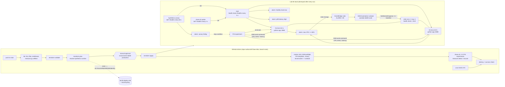

# Lab 08 — Self-healing production: I break it on purpose, it fixes itself

> **Status: code only, not yet deployed.** Everything below describes what the code
> does and how it is verified. The results table at the end is **filled in by the
> first run**; until then there are no measured numbers in this README, on purpose.

**What it builds:** a small but production-shaped web tier — an **ALB** in front of an
**Auto Scaling group** of 2 × t3.micro (Amazon Linux 2023, a ~70-line standard-library Python app with
`/healthz`, two AZs, no SSH) — and then everything needed to **break it on purpose
and prove it heals**:

- a **CloudWatch Synthetics canary** that requests `/healthz` from outside the VPC
  every minute (the customer's view; it is also the safety brake),
- **four CloudWatch alarms**: canary failing, healthy hosts below baseline, CPU
  saturated, p90 latency high,
- **event-driven remediation**: the CPU alarm's state changes go through
  **EventBridge** to an **SSM Automation runbook** that scales the ASG out by one
  instance on `ALARM` and back to the baseline on `OK`,
- three **AWS Fault Injection Service (FIS)** experiment templates — terminate one
  instance, 100 % CPU on every instance (`AWSFIS-Run-CPU-Stress`), +200 ms network
  latency (`AWSFIS-Run-Network-Latency`, optional) — each with the canary alarm as
  its **stop condition**,
- `chaos.sh` + `measure.py`, which run the experiments one at a time against the
  live system and **measure time-to-detect and time-to-recover** from timestamps AWS
  recorded (FIS, CloudWatch alarm history, SSM executions, target health) plus a
  2-second HTTP probe, writing `evidence/lab08/<experiment>.json` and a markdown report.

It is deployed by GitHub Actions (OIDC role, manual approval) and **torn down at the
end of every run**, with a nightly 03:00 UTC destroy as the backstop.



## Layout
```
labs/08-self-healing-chaos/
├── versions.tf          providers (aws 5.100.0, archive) + default tags (project, lab, run_id, stack=app)
├── main.tf              VPC 10.80/16 (2 public subnets, IGW, no NAT), SGs, ALB, launch template, ASG
├── iam.tf               five least-privilege roles: web (SSM), canary, FIS, remediation, EventBridge
├── observability.tf     canary + artifact bucket (1-day expiry), the four alarms
├── remediation.tf       SSM Automation document + two EventBridge rules (ALARM -> out, OK -> in)
├── chaos.tf             three FIS experiment templates, stop condition = canary alarm
├── outputs.tf           what exercise.sh, chaos.sh and the workflows read
├── variables.tf         every knob, with the reasoning in its description
├── app/app.py           the web app (stdlib only); app/user_data.sh.tftpl installs it as a systemd unit
├── canary/canary.py     the Synthetics canary (urllib, no browser)
├── runbooks/scale.yaml  the remediation runbook (schemaVersion 0.3, aws:executeScript)
├── exercise.sh          smoke test: proves the wiring BEFORE any chaos (same script locally and in CI)
├── chaos.sh             runs the experiments, records the live system, collects AWS's records
├── measure.py           turns records into MTTD/MTTR JSON + report; `selftest` proves it can say FAIL
├── bootstrap/           ONE-TIME: adds the lab 08 permissions to lab 06's deploy role
├── backend.tf.example   copy to backend.tf (git-ignored) for remote state
└── .skip-run-all        run-all.sh skips this lab (CI deploys it; FIS bills per action-minute)
.github/workflows/lab08.yml          the pipeline
.github/workflows/lab08-destroy.yml  teardown (end of every run, 03:00 UTC cron, manual)
```

## Concepts demonstrated
- **Self-healing is layers, and each layer has a different clock.** Innermost first:
  `systemd Restart=always` brings a crashed process back in ~1 s; the ALB health check
  (every 5 s, 2 failures) stops sending traffic to a sick instance in ~10 s; the ASG with
  `health_check_type = ELB` replaces an instance the ALB calls unhealthy (minutes: boot +
  `dnf` + app start + two healthy checks); the alarm → EventBridge → runbook path adds
  capacity (minutes: 1-minute metrics + alarm evaluation + instance launch). The lab
  measures the outer two.
- **N+1 is what makes "an instance died" a non-event.** With two instances behind an
  ALB, terminating one should cost few or zero failed requests. The 2-second probe is
  there to find out how many; the 1-per-minute canary is too coarse to see a gap
  shorter than a minute, and the README says so instead of pretending otherwise.
- **Chaos engineering with a brake.** Each FIS template has a stop condition: if the
  canary success rate falls below 50 % for two minutes (customers are affected), FIS
  halts the experiment and rolls back the SSM-based faults. The FIS role's IAM policy —
  not the template — is the blast radius: it can only terminate or send commands to
  instances tagged `lab08-role=web`.
- **Remediation as code, triggered by events, not polling.** CloudWatch publishes every
  alarm state change to EventBridge for free; a rule matches the CPU alarm's ARN and
  starts a versioned SSM Automation document with a role that can do exactly one thing
  (`SetDesiredCapacity` on this ASG). Each run leaves an execution record with inputs
  and outputs, which is what `chaos.sh` times.
- **The alarm statistic is a design decision.** The CPU alarm uses **Maximum**, not
  Average: with Average, the idle instance the runbook adds pulls the mean under the
  threshold, the alarm clears, the runbook scales in, the mean rises — flapping for as
  long as the stress lasts.
- **A detector that has never fired has never been tested.** The smoke test forces the
  CPU alarm into `ALARM` (`set-alarm-state`) and requires the runbook to scale the ASG
  out — and back in when CloudWatch re-evaluates the alarm to `OK` — before any FIS
  money is spent. `measure.py selftest` feeds the measurement records of a system that
  never recovers, a blind alarm, an alarm that fired *before* the fault, a broken
  EventBridge wiring and a stop-condition halt, and CI fails unless each is reported FAIL.
- **Measure the thing, not a correlate.** "Recovered" for the terminate experiment is
  healthy ALB targets back at the baseline (sampled every 5 s from the target group),
  not "the alarm cleared" — the alarm is a 1-minute statistic that lags the event.
  Where an alarm *is* the definition (CPU, latency), the report says so.

## Decisions and trade-offs
| Decision | Chosen | Alternatives and why not (here) |
|---|---|---|
| Fault injection | **AWS FIS** with AWS-owned SSM documents | **Hand-rolled** (`aws ec2 terminate-instances`, `ssh stress-ng`): free, but no stop conditions, no audit trail, no rollback of the fault, and no FIS vocabulary to discuss. **Chaos Mesh / Litmus**: Kubernetes-only. **Gremlin**: SaaS, paid. |
| Remediation for CPU | **alarm → EventBridge → SSM Automation** (+1 instance, back on OK) | **Target-tracking scaling policy**: would do the scale-out alone and is often the right production answer. The runbook path is chosen because it is the general pattern for remediations a scaling policy cannot express (restart a service, rotate a node, fail over) and because it leaves a per-incident execution record. Both are explainable; the README does not claim the runbook beats the policy. **Lambda target**: same idea, but a function to package, version and log; SSM Automation is declarative, has a built-in execution history and needs no code deploy. |
| Remediation for latency | **None (detect-only)** | When every instance is slow, replacing or adding instances does not fix it; a runbook here would be theatre. The lab measures time-to-detect. |
| Remediation for a dead instance | **ASG + ELB health checks** | A runbook that calls `SetInstanceHealth` would duplicate what `health_check_type = ELB` already does. |
| Detection source | **Canary (outside-in) + ALB/EC2 alarms (inside-out) + 2-s probe** | The canary alone has 60-s resolution; the probe alone runs only during `chaos.sh`. Each fills the other's gap. |
| Network | **2 public subnets, no NAT** | A NAT gateway ($0.045/h) would be the single largest line item. Instances have public IPs for `dnf` and the SSM endpoints; their security group admits only the ALB, and there is no SSH. Private subnets + NAT or VPC endpoints is the production layout (lab 07 has it). |
| Instance type | **t3.micro, CPU credits `unlimited`** | In `standard` mode a fresh t3 has ~0 credits and is throttled to its 10 % baseline under stress, so CPU would plateau near 10 % and the 80 % alarm could never fire: the experiment would "prove" a blind detector. Unlimited bills surplus credits instead (≈ $0.005 per instance per stress run). |
| Metrics resolution | **EC2 detailed monitoring (1 min)** | Basic 5-minute metrics would add up to 5 minutes to every CPU time-to-detect. |
| Canary runtime | **newest non-deprecated `syn-python-selenium-*`, resolved at plan time** | Runtimes are deprecated on AWS's schedule and a canary cannot be created on a deprecated one. The script uses only `urllib`, so any Python runtime works. |
| Teardown | **at the end of every pipeline run** + 03:00 UTC cron | Lab 07 stays up for a human to look at; lab 08's output is the evidence artifact, so there is nothing to look at afterwards. `keep_stack` on a manual run leaves it up. |
| Deploy identity | **lab 06's role + an extra inline policy** (`bootstrap/`) | Same as lab 07: one role, one trust policy to audit. |

## Cost (us-east-1 list prices, approximate — verify on the pricing pages)
| Resource | Price | Per run (stack up ~1 h) |
|---|---|---|
| ALB | $0.0225/h + LCU (~$0.008/h at this traffic) | ≈ $0.031 |
| 2 × t3.micro on-demand (a 3rd for a few minutes during remediation) | $0.0104/h each | ≈ $0.022 |
| EC2 detailed monitoring | $2.10 per instance-month (7 metrics) ≈ $0.0029/h each | ≈ $0.006 |
| Public IPv4 (2 instances + 2 ALB nodes) | $0.005/h each | ≈ $0.020 |
| Synthetics canary, 1 run/min | $0.0012 per run → 60 runs/h | ≈ $0.072 |
| Canary Lambda (960 MB, ~2 s/run) | ≈ 115 GB-s/h × $0.0000167 | ≈ $0.002 |
| CloudWatch alarms (4, standard resolution) | $0.10 per alarm-month, prorated | < $0.001 |
| t3 unlimited surplus credits during CPU stress | $0.05 per vCPU-hour | ≈ $0.01 |
| EventBridge, SSM Automation (a few steps), S3 artifacts, logs | free tier / fractions of a cent | ≈ $0 |
| **Infrastructure subtotal** | **≈ $0.15/h** | **≈ $0.15** |
| FIS `terminate` | $0.10 per action-minute (≈ 1 min) | $0.10 |
| FIS `cpu_stress` | 180 s of stress + command start, action duration ≤ 4 min | ≤ $0.40 |
| FIS `network_latency` (optional, `run_latency`) | 120 s, action duration ≤ 3 min | ≤ $0.30 |
| **Total per run** | | **≈ $0.65 default, ≈ $0.95 with the latency experiment** |

Arithmetic: 0.031 + 0.022 + 0.006 + 0.020 + 0.072 + 0.002 + 0.01 ≈ $0.16 of
infrastructure for one hour, plus $0.10 + $0.40 of FIS = **$0.66**; plus $0.30 if the
latency experiment runs = **$0.96**. The FIS lines are upper bounds (action duration
as configured); the actual billed minutes are in each experiment's FIS record. A stack
forgotten with `keep_stack` until the 03:00 UTC destroy costs ≈ $0.15/h — at most
about $3.60 for a full day. Lab 06's account-wide **AWS Budget** ($5/month, email at
80 %/100 % actual and 100 % forecast) covers this lab too.

## Bootstrap order (after lab 06's bootstrap; the first apply is CI's)
1. **Let the deploy role's trust accept the lab 08 approval environment.** Lab 06's
   bootstrap variable `extra_github_environments` defaults to `["lab07-production"]`;
   re-apply it with both environments (an in-place trust-policy update, free):
   ```bash
   cd labs/06-ecs-fargate-cicd/bootstrap
   terraform apply -var alert_email=you@example.com \
     -var 'extra_github_environments=["lab07-production","lab08-production"]'
   ```
   (Or change that variable's default in lab 06 so a later plain re-apply keeps it.)
2. **Attach the lab 08 permissions to that role** (Auto Scaling, Synthetics and its
   `cwsyn-*` Lambda, FIS, EventBridge, the runbook document, `awslabs-lab08-*` roles +
   instance profile, the canary bucket, `lab08/*` state — all in
   [`bootstrap/main.tf`](bootstrap/main.tf)):
   ```bash
   cd labs/08-self-healing-chaos/bootstrap
   terraform init
   terraform apply \
     -var deploy_role_arn="$(cd ../../06-ecs-fargate-cicd/bootstrap && terraform output -raw deploy_role_arn)" \
     -var tf_state_bucket="$(cd ../../06-ecs-fargate-cicd/bootstrap && terraform output -raw tfstate_bucket)"
   ```
   IAM limits the **inline** policies of one role to 10,240 characters in total. Rendered
   offline with placeholder ARNs (whitespace removed), lab 06's policy is ≈ 2,060
   characters, lab 07's ≈ 2,760 and lab 08's ≈ 3,370: ≈ 8,190 together, inside the limit
   with ~2,000 to spare. A lab 09 on the same role would need a managed policy instead.
3. **Create the approval environment** (the bootstrap prints this command too):
   ```bash
   gh api --method PUT repos/ravikus1457/aws-labs/environments/lab08-production \
     --input - <<< "{\"reviewers\":[{\"type\":\"User\",\"id\":$(gh api user -q .id)}]}"
   ```
   The repo variables (`AWS_REGION`, `AWS_DEPLOY_ROLE_ARN`, `TF_STATE_BUCKET`) are lab 06's.
4. **Push to `main`** touching `labs/08-self-healing-chaos/` (or *Run workflow*,
   optionally with `run_latency` / `keep_stack`). Watch: lint → validate → plan →
   **waiting for approval** → apply (~4 min: ALB + instances healthy) → smoke (~6–10 min,
   most of it waiting for the canary's first run and the forced-alarm round trip) →
   chaos (~20–35 min) → teardown. The chaos job's summary is the report.

> GitHub disables scheduled workflows after 60 days without repo activity. If this
> repo goes quiet, run `lab08-destroy` by hand after any `keep_stack` run.

### Running it locally instead (no CI)
```bash
# needs: terraform, aws, jq, curl, python3; credentials with the deploy role's rights
cd labs/08-self-healing-chaos
terraform init && terraform apply
terraform output -json > outputs.json
OUTPUTS_JSON=outputs.json ./exercise.sh evidence/smoke
OUTPUTS_JSON=outputs.json ./chaos.sh evidence/lab08                 # terminate + cpu_stress
OUTPUTS_JSON=outputs.json ./chaos.sh evidence/lab08 network_latency # optional
terraform destroy   # then delete /aws/lambda/cwsyn-lab08-alb-probe-* (Lambda created it, not Terraform)
```
`scripts/run-all.sh` skips this lab (marker file `.skip-run-all`).

## What the smoke job verifies (before any chaos)
`exercise.sh` **asserts**:
- `GET http://<alb>/healthz` → **200 `{"status":"ok"}`**; 30 × `GET /` reach **≥ 2
  distinct instances** (instance id + AZ in each response)
- **target group healthy = baseline**; the ASG's health check type is **ELB**
- **both instances Online in SSM**, and an SSM `AWS-RunShellScript` finds **`stress-ng`,
  `tc`, the interface the latency fault shapes (`ens5`) and the app unit** on every one —
  the dependencies the FIS documents need, checked before FIS bills for them
- the **three FIS templates exist** and each one's stop condition **is the canary alarm**
- **all four alarms exist**; the **canary is RUNNING** with **≥ 1 PASSED run**
- **remediation fires:** `set-alarm-state ALARM` on the CPU alarm → EventBridge → the
  runbook **raises desired capacity**; when CloudWatch re-evaluates the alarm to `OK`,
  the second rule **scales back to the baseline** (WARN, not FAIL, if that takes > 6 min)

## What the chaos job measures
For each experiment, `chaos.sh` waits for **steady state** (baseline healthy, no alarm in
ALARM, no experiment running), records 20 s of baseline, starts the FIS experiment, waits
for **recovery** (not a fixed timer), then collects what AWS recorded and runs `measure.py`.

| Experiment | Fault | Detection | Remediation | Recovered when |
|---|---|---|---|---|
| `terminate` | `aws:ec2:terminate-instances`, 1 instance | `healthy-hosts-low` → ALARM | ASG replaces the instance | healthy targets back to baseline (5-s samples) |
| `cpu_stress` | `AWSFIS-Run-CPU-Stress`, all instances, 180 s | `cpu-high` → ALARM | EventBridge → runbook: +1 instance; on OK: back to baseline | `cpu-high` back to OK (and ASG back at baseline) |
| `network_latency` (optional) | `AWSFIS-Run-Network-Latency`, +200 ms, all instances, 120 s | `latency-high` (ALB p90) → ALARM | none (detect-only) | `latency-high` back to OK |

Per experiment it reports time-to-detect, time-to-recover, for CPU how long after
detection the runbook started and when the extra instance was InService, and the
**user impact**: failed 2-s probes, longest failure streak, p50/p95 latency during the
fault vs. baseline, and failed canary runs. PASS requires detection and recovery (and,
for CPU, a successful scale-out execution and an extra instance InService); a FIS
experiment that ends `stopped` (stop condition) or `failed` is a FAIL.

Evidence: `evidence/lab08/<experiment>.json`, `evidence/lab08/chaos-report.md` and the
raw records under `evidence/lab08/raw/<experiment>/` (FIS experiment, alarm history,
runbook executions, canary runs, ASG activities, probe and sample logs), uploaded as the
`lab08-evidence-<run>` artifact (14 days). Every number is recomputable from the raw
records with `python3 measure.py experiment raw/<experiment> out.json`.

## Results
**First green run: GitHub Actions run 38814313911, 2026-10-16 (UTC).** Measured, not estimated; raw
probes, alarm history, FIS records and runbook executions are in
[`evidence/run-38814313911-20261016`](evidence/run-38814313911-20261016) (account id redacted).

| Experiment | Time to detect | Time to recover | Failed probes / total | Longest outage seen by a 2-s probe | Canary failed runs | Remediation |
|---|---|---|---|---|---|---|
| terminate | 131.4 s (healthy-hosts-low) | 60.9 s (ALB targets back to 2) | 1 / 29 | 2.1 s | 0 / 3 | ASG replacement via ELB health check |
| cpu_stress | 140.6 s (cpu-high) | 320.6 s (cpu-high back to OK) | 0 / 151 | 0 s | 0 / 7 | alarm -> EventBridge -> SSM runbook +1 instance (InService 166.6 s after the fault), then scaled back to 2 |
| network_latency | not run (optional, `run_latency`) | | | | | |

Smoke test before the chaos: 13/13 PASS, including a forced ALARM proving alarm -> EventBridge ->
runbook scales out (2/2 executions Success) and back in. Teardown: 44 destroyed, every survivor
category empty.

What the first runs taught (each fixed in code, see git log): `CreateCanary` reads AWS's
Synthetics library bucket with the caller's credentials; a failed `CreateCanary` orphans Lambda
layers; EventBridge `FailedInvocations` gives no reason, so the targets now dead-letter to SQS and
the smoke test prints `ERROR_CODE/ERROR_MESSAGE` plus the deployed policy, which showed that
`ssm:StartAutomationExecution` is authorized on the document, the automation definition AND the
new execution.

## Teardown
- **Automatic:** the pipeline's `teardown` job (end of every run unless `keep_stack`),
  `lab08-destroy` nightly at 03:00 UTC, and on demand. Order: stop any running lab 08
  FIS experiment → `terraform destroy` (stops/deletes the canary and, with
  `delete_lambda`, its Lambda function + layer) → delete the canary's Lambda log group
  (Lambda created it; Terraform never owned it) → count survivors from the owning
  services: VPC, instances, ASG, launch template, ALB, target group, canary, Lambda
  functions/layers, log groups, alarms, EventBridge rules, SSM documents, FIS templates,
  the canary bucket, IAM roles and instance profiles. The tagging index is printed for
  information only (it lags deletes).
- **Bootstrap:** `cd bootstrap && terraform destroy` removes the extra policy from lab
  06's role. Lab 06's own bootstrap is untouched.

## Résumé bullet (only after the first run, with its numbers — make sure you can explain every word)
> Built a self-healing AWS web tier in Terraform (ALB, Auto Scaling group with ELB
> health checks, CloudWatch Synthetics canary, alarm → EventBridge → SSM Automation
> remediation) and validated it with AWS Fault Injection Service experiments —
> instance termination, CPU saturation, network latency — under a canary-alarm stop
> condition, measuring time-to-detect and time-to-recover from AWS-recorded timestamps
> in a GitHub Actions OIDC pipeline with manual approval and automatic teardown.

Add the measured MTTD/MTTR from the evidence artifact to the bullet once you have them.

## Be ready to explain
- **The four healing layers and their clocks** (systemd, ALB health check, ASG, alarm →
  runbook): which fault each one handles and why the outer ones are minutes, not seconds.
- **Why terminating one of two instances may cost zero failed requests** — and what the
  probe would show if deregistration delay, health-check interval or a single AZ were
  configured differently.
- **FIS anatomy:** template = targets (tag + filter + selection mode) + actions +
  stop conditions + role. Why the IAM policy, not the template, is the blast radius.
  What happens to an SSM-based fault when the stop condition fires.
- **Why the CPU alarm uses Maximum**, what flapping would look like with Average, and
  why the alarm stays in ALARM after scale-out (the stressed instances are still hot —
  the new capacity absorbs traffic, it does not cool the old instances).
- **EventBridge → SSM Automation:** the event pattern (source, detail-type, resources,
  `previousState`), how the target passes parameters, which role is passed to whom
  (events role starts the automation, remediation role runs it).
- **Runbook vs. target-tracking policy** — when each is right.
- **Why `unlimited` CPU credits** are required for the CPU experiment to mean anything.
- **What the canary can and cannot see** (60-s resolution) and why the probe exists.
- **Time-to-detect vs. time-to-recover** as this lab defines them, the clock both are
  measured from (FIS action start), and which number is an alarm statistic.
- **The exact cost of a run** and which line item dominates (FIS action-minutes, then
  the canary).
