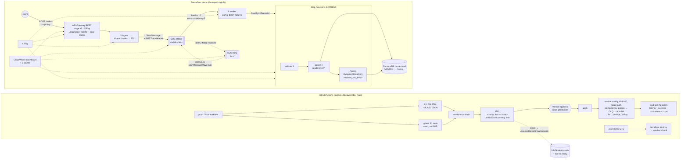

# Lab 09 — Serverless event pipeline (thousands of orders, pennies per run)

**What it builds:** an event-driven order pipeline with no servers, no VPC and
nothing billed by the hour. `POST /orders` hits **API Gateway** (REST, API key +
usage plan), an **ingest Lambda** checks the order's shape and drops it on an **SQS
queue** (202 in milliseconds), a **worker Lambda** drains the queue at a capped
concurrency and runs a **Step Functions Express** workflow per order — *Validate*
(Lambda) → *Enrich* (Lambda, prices from the catalog) → *Persist* (direct DynamoDB
integration, conditional write) — into an on-demand **DynamoDB** table. **X-Ray**
traces the API stage, all four functions and the state machine; a **CloudWatch
dashboard** shows requests, latency p50/p99, queue depth, DLQ, errors, throttles and
concurrency; **five alarms** watch it. Messages that keep failing land in a
**dead-letter queue** and are replayed with a **redrive** script once the cause is fixed.

The pipeline is checked in three layers:
- **81 unit tests** (pytest, moto, no AWS account), including sandbox runs of the
  smoke and load-test scripts that must report FAIL when the fault path is broken.
- **A smoke test** against the deployed stack. It sends a poison message and watches
  it fail, land in the DLQ and fire the DLQ alarm. Then it fixes the catalog,
  redrives the message and watches the same order persist.
- **A load test.** It sends 2,000 orders (configurable), reads every accepted order
  back from DynamoDB and **measures** p50/p99 latency, success rate, end-to-end
  latency, max concurrency and the **AWS cost of the run** from published unit
  prices, with the arithmetic shown.

> **Status: code only, not yet deployed.** Everything below marked *estimate* is
> arithmetic from list prices. Everything marked *measured* is filled in by the first
> real run (see [Measured results](#measured-results-filled-in-by-the-first-run)).



## Layout
```
labs/09-serverless-event-pipeline/
├── versions.tf          providers (aws, archive) + default tags (project, lab, run_id, stack=app)
├── main.tf              names, the Lambda package (archive_file of src/)
├── api.tf               REST API, POST /orders (AWS_PROXY), stage v1 (X-Ray), API key, usage plan
├── lambda.tf            4 roles (one policy each), 4 log groups, 4 functions, SQS → worker mapping
├── queue.tf             orders queue, DLQ, redrive-allow policy
├── stepfunctions.tf     EXPRESS state machine, its role, its log group
├── dynamodb.tf          table (pk only, TTL) + catalog items
├── monitoring.tf        dashboard (6 metric widgets + alarm strip) + 5 alarms
├── outputs.tf           what the tools and workflows read (no secrets)
├── variables.tf         every knob, with the reasoning in its description
├── statemachine/order-workflow.asl.json   Validate → Enrich → Persist (templatefile)
├── src/orders/          the Lambda package: model.py (pure logic), ingest.py, worker.py, steps.py
├── tests/               pytest: model, handlers (moto), ASL contract, cost maths, tool sandboxes
├── tools/smoke.py       post-deploy assertions incl. the fault path (PASS/FAIL/WARN)
├── tools/loadtest.py    N orders → measured latency/success/concurrency/cost → evidence
├── tools/redrive.py     DLQ → orders queue (report-only unless --apply)
├── tools/cost.py        unit prices + the arithmetic (unit-tested)
├── bootstrap/           ONE-TIME: adds the lab 09 permissions to lab 06's deploy role
├── backend.tf.example   copy to backend.tf (git-ignored) for remote state
└── .skip-run-all        scripts/run-all.sh skips this lab (CI deploys it)
.github/workflows/lab09.yml          the pipeline
.github/workflows/lab09-destroy.yml  03:00 UTC teardown + survivor check
```

## Concepts demonstrated
- **Accept fast, process later.** The API's job ends when the order is durably queued.
  The ingest Lambda checks the order's shape (no network calls apart from SQS) and
  answers 202. Catalog lookups and writes happen behind the queue. A burst at the
  front door becomes queue depth, not errors.
- **Back-pressure is a setting.** The SQS event source's `maximum_concurrency` (5 by
  default, 2 on small accounts) caps the number of workers however deep the queue gets.
  The `queue_backlog_age` alarm says when that cap is too low. The API side is capped
  separately by the usage plan's throttle.
- **Partial batch failure.** The worker returns `batchItemFailures` for exactly the
  messages whose workflow did not succeed. One bad order costs its own retries, not
  the other nine in the batch.
- **Poison messages and the DLQ.** An order for a SKU the catalog does not have yet
  (the ingest Lambda cannot know the catalog) fails Enrich on every attempt. After
  `maxReceiveCount` = 2 deliveries SQS moves it to the DLQ and the DLQ alarm fires.
  Once the SKU is added, `tools/redrive.py --apply` moves the message back with
  `StartMessageMoveTask`, the same API as the console's *Start DLQ redrive* button.
  The DLQ's redrive-allow policy names one source queue, so redrive cannot send
  messages anywhere else. The smoke test runs this whole path.
- **Idempotency under at-least-once delivery.** SQS and Express workflows can both
  deliver twice. A client `Idempotency-Key` becomes the order id, and Persist writes
  with `attribute_not_exists(pk)`. A duplicate hits `ConditionalCheckFailedException`,
  which the state machine catches and treats as success. The smoke test posts the
  same key twice and checks that the stored item did not change.
- **Service integrations instead of glue code.** Persist is a native `dynamodb:putItem`
  task, so there is no Lambda in that step and no code to maintain. Validate and
  Enrich are Lambdas because they hold logic worth unit-testing.
- **Least privilege you can read.** Each function has its own role:
  - **ingest** may `sqs:SendMessage` to one queue.
  - **worker** may consume that queue and `StartSyncExecution` one state machine.
  - **validate** has no AWS permissions.
  - **enrich** may read DynamoDB keys starting `SKU#` (a `dynamodb:LeadingKeys`
    condition).
  - **the state machine** may invoke two functions and write keys starting `ORDER#`.

  None of the roles may create log groups, so a late invocation during destroy
  cannot re-create a deleted one.
- **Tracing across async hops.** X-Ray is on for the stage, the four functions and the
  state machine. No X-Ray SDK is packaged, so the ingest Lambda passes its trace
  header to SQS as the `AWSTraceHeader` system attribute. The worker passes it on to
  `StartSyncExecution(traceHeader=…)`. Whether one trace actually continues end to
  end is **recorded by the smoke test, not claimed**: it is a WARN line, not an
  assertion.
- **Measure the cost.** The load test reads usage back from CloudWatch: API count,
  Lambda billed duration from the REPORT records (which include the INIT phase AWS
  has billed since 2025-08), Step Functions executions, DynamoDB consumed units, SQS
  requests, X-Ray traces and log bytes. It multiplies each by the unit prices in
  `tools/cost.py` and prints every line with its arithmetic. If CloudWatch has not
  caught up yet, the report says the figure is a lower bound.

## Decisions and trade-offs
| Decision | Chosen | Alternatives and why not (here) |
|---|---|---|
| API flavour | **REST API** (regional) | **HTTP API** is $1.00/M instead of $3.50/M and has lower latency, but **does not support X-Ray tracing**, and tracing the edge is part of this lab. At 2,000 requests the difference is $0.005. For a high-volume API without that need, HTTP API is the right call. |
| Edge auth | **API key + usage plan** (metering) | An API key is not authentication. Here it is a **cost cap**: 1,000 rps throttle and a **25,000-requests/day quota**, which bounds API spend at about $0.09/day even if the key leaks. Real users would get Cognito/JWT or IAM auth. |
| Buffer | **SQS standard + DLQ** | **EventBridge**: better for fan-out to many consumers, but it has no consumer-side back-pressure and still needs SQS behind each target. **Kinesis**: ordering per shard, but you provision shards and a poison record blocks its shard. **FIFO SQS**: exactly-once processing and ordering, but lower throughput and none is needed (orders are independent; idempotency covers duplicates). |
| Workflow | **Step Functions EXPRESS, synchronous** | **Standard** bills $25 per million *state transitions* (3+ per order here) and keeps 90 days of history, which suits long-running human-in-the-loop flows. **Express** bills $1 per million executions + duration and runs up to 5 minutes, which fits this short, idempotent, high-volume shape. Running it **synchronously** lets the worker see the result and turn a failure into an SQS retry. An asynchronous Express run would have to handle its own failures. **No Step Functions** (all logic in the worker) is cheaper still, but loses the visual workflow, per-step retries and the no-code Persist. |
| Retry layers | Step Functions retries **transient** errors (Lambda throttles, DynamoDB throttling) inside an attempt. SQS retries **the whole message** (`maxReceiveCount` = 2). | The smoke test needs a quick fault path (about 3–4 min). A larger `maxReceiveCount` only adds delay for messages that will never succeed. |
| Table design | **Single table, `pk` only**, on-demand, TTL 7 days on orders | Two tables would be more familiar, but sharing one table with key prefixes is what makes the LeadingKeys IAM conditions possible. There are no GSIs because nothing queries by another attribute. **Provisioned capacity** is cheaper at a steady load, which this lab does not have. **PITR** is off: the data is synthetic and continuous backups bill per GB-month. |
| Lambda | **Python 3.12, arm64, 128 MB**, one package for four handlers | Pure Python with no native dependencies, so arm64 is about 20% cheaper with nothing to cross-build. 128 MB is enough for JSON + one AWS call; the load test's Duration figures would show if CPU were the bottleneck. Shipping one package for four handlers means there is one artifact to review. |
| Sizing | Read from the account at **plan time** | New accounts can have an account-wide Lambda concurrency limit as low as **10**. The plan job reads it. Below 100 it sets worker concurrency to 2, batch parallelism to 1 and load-test client concurrency to 8. Otherwise 5, 4 and 25. The settings travel with the reviewed plan (the same pattern as lab 07 resolving the Kubernetes version). |
| Observability | Basic stage metrics, X-Ray, Lambda JSON logs, Express logs at **ERROR** | API Gateway **access logs** need the *account-wide* API Gateway CloudWatch role (`aws_api_gateway_account`). That is a global setting an ephemeral lab should not own. Express logging at `ALL` with execution data would multiply log ingestion per order. |
| Deploy identity | **lab 06's role + one more policy** (`bootstrap/`) | Same reasoning as lab 07: a second role means a second trust policy to audit. The policy is inline by default. IAM caps a role's *aggregate* inline policies at 10,240 characters, and labs 06–09 share one role, so `attach_as_managed_policy = true` switches to a customer-managed policy if that cap is hit. |

## Cost
Nothing in this stack bills by the hour except the dashboard ($3/month) and the five
alarms ($0.10/month each). Both are prorated, so together they cost about $0.005 per
hour the stack exists.

**Estimate for one CI run** (smoke + 2,000 orders), using the prices in `tools/cost.py`
(us-east-1 list prices, before free tier). The usage figures are assumptions written
down before any run: about 40 ms per ingest call, 400 worker batches, 150 ms per
workflow, ~6 MB of logs.

| Item | Arithmetic | Estimate |
|---|---|---|
| API Gateway REST | 2,000 × $3.50/1M | $0.0070 |
| Lambda requests | 6,400 × $0.20/1M | $0.0013 |
| Lambda duration (arm64) | 47.5 GB-s × $0.0000133334 | $0.0006 |
| Step Functions Express requests | 2,000 × $1.00/1M | $0.0020 |
| Step Functions Express duration | 2,000 × 0.2 s × 64 MB = 25 GB-s × $0.00001667 | $0.0004 |
| DynamoDB writes / reads | 2,000 WRU × $0.625/1M + 3,000 RRU × $0.125/1M | $0.0016 |
| SQS (upper bound) | 7,000 × $0.40/1M | $0.0028 |
| X-Ray | 250 traces × $5.00/1M + 250 × $0.50/1M | $0.0014 |
| CloudWatch Logs | ~0.006 GB × $0.50 | $0.0029 |
| Alarms + dashboard (1 h) | 5 × $0.10/730 + $3.00/730 | $0.0048 |
| Report's own reads (GetMetricData, Logs Insights) | 45 × $0.01/1000 + ~0 | $0.0005 |
| **Total** | | **≈ $0.025 per run** |

- That is **≈ $0.010 per 1,000 orders**, not counting the hourly alarm/dashboard
  share. API Gateway REST is the largest single line (35%).
- **After free allowances, about $0.011.** The always-free monthly allowances cover
  1M Lambda requests + 400k GB-s, 1M SQS requests, 100k X-Ray traces, 5 GB of logs,
  10 alarms and 3 dashboards. That removes most lines on an otherwise idle account.
  These still bill:
  - Step Functions Express (≈ $0.0024): no always-free allowance.
  - DynamoDB on-demand requests (≈ $0.0016): the always-free DynamoDB allowance is for
    provisioned capacity.
  - API Gateway (≈ $0.007): its 1M calls/month is a first-12-months offer, or comes out
    of free-plan credits on accounts created after July 2025.
- **The load job computes the real figure** from measured usage and writes it to
  `cost.json` and `summary.md`. Where the two disagree, trust the measured figure.

A leaked API key cannot run up a bill: the usage-plan quota caps the stack at 25,000
requests a day. That is about $0.09 of API Gateway, and every downstream service is
bounded by the same count. Lab 06's account-wide **AWS Budget** ($5/month) is the
backstop, and the 03:00 UTC destroy removes the stack every night anyway.

## Bootstrap order (after lab 06's bootstrap; the first apply is CI's)
1. **Let the deploy role trust the lab 09 approval environment.** Re-apply lab 06's
   bootstrap with `lab09-production` added to `extra_github_environments` (an in-place,
   free trust-policy update). Keep the environments that are already listed:
   ```bash
   cd labs/06-ecs-fargate-cicd/bootstrap
   terraform apply -var alert_email=you@example.com \
     -var 'extra_github_environments=["lab07-production","lab09-production"]'
   ```
2. **Attach the lab 09 permissions** (Lambda, SQS, Step Functions, DynamoDB, log groups
   and roles named `awslabs-lab09-*`; API Gateway, CloudWatch and X-Ray reads
   region-scoped; `lab09/*` state objects — all in [`bootstrap/main.tf`](bootstrap/main.tf)):
   ```bash
   cd labs/09-serverless-event-pipeline/bootstrap
   terraform init
   terraform apply \
     -var deploy_role_arn="$(cd ../../06-ecs-fargate-cicd/bootstrap && terraform output -raw deploy_role_arn)" \
     -var tf_state_bucket="$(cd ../../06-ecs-fargate-cicd/bootstrap && terraform output -raw tfstate_bucket)"
   # LimitExceeded on PutRolePolicy = the role's 10,240-char inline quota is full:
   #   re-run with -var attach_as_managed_policy=true (needs iam:CreatePolicy + AttachRolePolicy)
   ```
3. **Create the approval environment**:
   ```bash
   gh api --method PUT repos/ravikus1457/aws-labs/environments/lab09-production \
     --input - <<< "{\"reviewers\":[{\"type\":\"User\",\"id\":$(gh api user -q .id)}]}"
   ```
   The repo variables `AWS_REGION`, `AWS_DEPLOY_ROLE_ARN` and `TF_STATE_BUCKET` are the
   ones lab 06 set.
4. **Push to `main`** touching `labs/09-serverless-event-pipeline/`, or use *Run workflow*
   (inputs: `requests`, `concurrency`). Watch it go: lint + test → validate → plan
   (step summary shows the account's concurrency limit and the sizing chosen) →
   **waiting for approval** → apply (~1–2 min) → smoke (~10 min, mostly waiting for
   the DLQ and the alarm) → load (~5–10 min including the wait for CloudWatch).
5. **Look at it:** the apply summary links the dashboard. To send an order yourself:
   ```bash
   KEY=$(aws apigateway get-api-key --api-key <api_key_id> --include-value --query value --output text)
   curl -s -X POST "<api_url>" -H "x-api-key: $KEY" -H 'content-type: application/json' \
     -d '{"customer_id":"me","items":[{"sku":"SKU-MUG","quantity":2}]}'
   ```
6. **Destroy:** Actions → *lab09-destroy* → *Run workflow*. The cron does it at 03:00
   UTC regardless and fails loudly if anything survives.

> GitHub disables scheduled workflows after 60 days without repo activity. If this
> repo goes quiet, run `lab09-destroy` by hand before walking away.

### Running it locally
```bash
cd labs/09-serverless-event-pipeline
python3 -m venv .venv && . .venv/bin/activate && pip install -r requirements-dev.txt
ruff check . && ruff format --check . && python -m pytest      # no AWS account needed
terraform init -backend=false && terraform validate
# deploy with your own credentials (creates real resources):
terraform init && terraform apply && terraform output -json > outputs.json
python tools/smoke.py    --outputs outputs.json --evidence evidence/local/smoke
python tools/loadtest.py --outputs outputs.json --evidence evidence/local/load --requests 2000 --concurrency 25
python tools/redrive.py  --outputs outputs.json            # report only; add --apply to move
terraform destroy
```

## What the tests prove
**Unit tests (`tests/`, 81, no AWS):**
- `test_model.py`: order validation (every rule, booleans are not quantities, all
  errors reported at once), body size cap, pricing, the unknown-SKU error, timestamp
  and TTL maths, trace-header sanitising.
- `test_ingest.py` (moto SQS): 202 + message on the queue; the Idempotency-Key becomes
  the order id; malformed input → 400 and nothing queued; queue failure → 503, not a
  crash; trace header propagated; a rejected trace header falls back to a plain send.
- `test_worker.py`: only failed messages land in `batchItemFailures` (sequential and
  threaded); FAILED/TIMED_OUT/throttling are failures; unparseable bodies never reach
  the workflow.
- `test_steps.py` (moto DynamoDB): Enrich prices from the catalog. An unknown SKU
  raises, then succeeds once the SKU is added: the redrive story in miniature.
- `test_statemachine.py`: the ASL parses after substitution and every `Next` exists.
  Every `$.field` that Persist reads is a string key that Enrich returns; that is the
  contract that would otherwise only fail in AWS. The `ORDER#` key prefix matches the
  IAM condition.
- `test_cost_and_stats.py`: each cost line equals the hand arithmetic; percentiles;
  peak in-flight.
- `test_loadtest_sandbox.py` / `test_smoke_sandbox.py`: a local HTTP server plays API
  Gateway and runs the **real** handlers against moto.
  - The load test must count 59/60 accepted and 59/59 persisted, and must fail below
    its success bar.
  - The smoke test must pass on a healthy pipeline and must report **FAIL** when the
    DLQ alarm never fires or when the fix does not fix.
- Mutation check, done once by hand while writing this lab: each of these was
  introduced on purpose and each made the suite fail.
  - an Enrich output field renamed
  - a number sent as a non-string
  - the worker's failure report inverted
  - TIMED_OUT treated as success
  - the key prefix changed
  - a dangling `Next` in the state machine
  - boolean quantities accepted
  - the Idempotency-Key ignored
  - a unit price changed

**Smoke test (`tools/smoke.py`, against the deployed stack):** it reads the
**deployed** configuration back from AWS, not from the Terraform files. It asserts:
- X-Ray tracing is Active on all four functions, enabled on the stage and on the
  EXPRESS state machine.
- The SQS → worker mapping is enabled with `ReportBatchItemFailures`, and the DLQ is
  wired.
- No API key → 403. A malformed order → 400.
- A valid order → 202, then persisted with the catalog-computed total.
- The same Idempotency-Key again → the queue drains and the stored item is unchanged.
- **The fault path:**
  1. A poison order → 202.
  2. It lands in the DLQ and is not persisted.
  3. **The DLQ alarm goes to ALARM after the fault.** The script checks the alarm's
     state-change timestamp; if the alarm was already in ALARM before the test, the
     result is a WARN, not a false PASS.
  4. The fix → redrive COMPLETED → the same order is persisted → the DLQ is empty.
- X-Ray recorded traces from API Gateway → Lambda and from Step Functions.

Plus recorded, not asserted: whether one trace id continued across SQS into Step
Functions, and every alarm's state. Evidence (account id redacted) lands in the
`lab09-evidence-smoke-<run>` artifact.

**Load test (`tools/loadtest.py`):** it fails the job if fewer than 99% of requests
return 202 **or any accepted order is missing from DynamoDB**. Evidence:
- `loadtest.json`: every measured number with its source
- `cost.json`: every cost line with its arithmetic
- `requests.json`: per request: status, latency, cold start
- `summary.md`: also shown in the job summary

## Measured results (filled in by the first run)
| Measure | Value | Source |
|---|---|---|
| Requests / success rate | _filled in by the first run_ | client |
| Client latency p50 / p99 | _filled in by the first run_ | client wall clock (GitHub runner → us-east-1) |
| API Gateway latency p50 / p99 | _filled in by the first run_ | CloudWatch |
| End-to-end p50 / p99 (accepted → persisted) | _filled in by the first run_ | DynamoDB item timestamps |
| Accepted → persisted | _filled in by the first run_ | DynamoDB read-back |
| Max concurrency (client / ingest environments / CloudWatch) | _filled in by the first run_ | three readings |
| Account Lambda concurrency limit | _filled in by the first run_ | `lambda:GetAccountSettings` |
| Cost of the run (list price) | _filled in by the first run_ | `cost.json` |
| Poison → DLQ → ALARM → redrive → persisted | _filled in by the first run_ | smoke log |

## Teardown
- **Automatic:** `lab09-destroy` runs nightly at 03:00 UTC and on demand. It:
  1. disables the SQS → worker mapping;
  2. runs `terraform destroy`;
  3. counts survivors by the `awslabs-lab09-` prefix from the **owning services**:
     Lambda functions and mappings, SQS, Step Functions, DynamoDB, API Gateway (APIs,
     keys, usage plans), both log-group prefixes, alarms, dashboards and IAM roles.

  The tagging index is printed for information only; it lags deletes.
- **Local:** `terraform destroy` (with the same `backend.tf` CI uses, or local state).
- **Bootstrap:** `cd bootstrap && terraform destroy` removes the extra policy from
  lab 06's role.
- **Last resort:** `scripts/guardrails.sh orphans` lists anything still tagged
  `project=awslabs`.

## Résumé bullet (defensible — make sure you can explain every word)
> Built an event-driven order pipeline on AWS with Terraform. It runs API Gateway →
> Lambda → SQS (DLQ + redrive) → Step Functions Express → DynamoDB, with X-Ray tracing,
> a CloudWatch dashboard and alarms, least-privilege IAM per function, and an API
> usage-plan quota as a cost cap. Deployed through a GitHub Actions OIDC pipeline with
> a manual approval gate. The pipeline unit-tests the Lambdas against moto, runs a
> smoke test that injects a poison message and proves the DLQ alarm fires and the
> redrive recovers it, and runs a load test that measures p50/p99 latency, success
> rate, concurrency and the per-run AWS cost. *(Add the measured numbers once the
> first run has produced them, and only those.)*

## Be ready to explain
- **Why a queue between the API and the work:** latency to the client vs throughput
  of the backend, burst absorption, retry isolation; what 202 promises and what it
  does not.
- **Visibility timeout:** why it is 6 × the function timeout, and what happens if it
  is shorter than the processing time (duplicate processing).
- **`maxReceiveCount` and the DLQ:** what counts as a receive, why the DLQ keeps
  messages longer than the source, and how redrive works (`StartMessageMoveTask`,
  the redrive-allow policy).
- **Partial batch responses vs raising:** what raising from an SQS-triggered Lambda
  does to the whole batch.
- **At-least-once everywhere:** where duplicates come from (SQS, Express, client
  retries) and why a conditional write plus a client idempotency key is the fix.
- **Express vs Standard Step Functions:** pricing model, duration limits, execution
  semantics, history, sync vs async start.
- **The two retry layers:** what Step Functions retries, what SQS retries, and how
  they multiply.
- **Lambda concurrency:** the account limit, `maximum_concurrency` on the event
  source vs reserved concurrency (and why reserved concurrency is not used on a
  10-concurrency account), cold starts, what INIT billing changed in 2025.
- **REST vs HTTP API:** price, features (X-Ray, usage plans, API keys), latency.
- **API keys are not auth:** what they meter, what to use instead (IAM, Cognito/JWT
  authorizers).
- **DynamoDB on-demand:** RRU/WRU per item size, eventually consistent reads costing
  half, why `LeadingKeys` conditions work with single-table design.
- **X-Ray sampling** (1 request/s + 5% by default): why the trace count is not the
  request count, and how the trace header crosses SQS without the SDK.
- **The cost arithmetic of a run** line by line, and which line dominates at
  1M orders/day.
