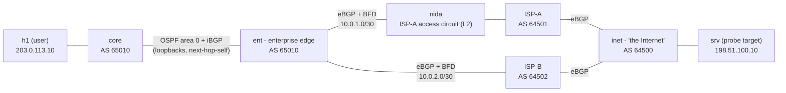

# Net Lab 06 — BGP multihoming with BFD: break the primary ISP under live traffic and measure the outage

> **Status: runs in CI; results table is filled by the first CI run.** Everything below describes what the
> lab does and how each claim is checked. No number appears in the Results table until a GitHub Actions run
> has produced it.

**What it proves.** An enterprise edge router (`ent`, AS 65010) is dual-homed to two ISPs over eBGP and
runs the policy a real edge needs: it announces **only its own prefix** (no transit, no leaks), **drops
bogons, its own address space and over-specific routes** that the ISPs (deliberately) send it, prefers
ISP-A **outbound with local-preference** and steers **inbound traffic to ISP-A with AS-path prepending**,
and watches both sessions with **BFD (100 ms × 3)**. The lab then breaks ISP-A three different ways while a
host sends a UDP probe every 10 ms in **each direction**, and measures — in milliseconds, from packet
logs and router state, not estimates — how long users lost traffic, how long BGP took to notice, when each
router's forwarding table moved to ISP-B, and that everything **fails back** to ISP-A after the repair.
The headline comparison is the same silent circuit failure with BFD on vs. off (BGP hold timer only).

It runs on a GitHub-hosted runner with **containerlab** and **FRRouting** containers: $0, no cloud account,
no secrets, torn down at the end of every run.

## Topology



`nida` is a plain Linux bridge standing in for ISP-A's access circuit (a metro-Ethernet NID / carrier
handoff). When it stops forwarding, **both routers' ports stay up** — the failure BFD exists for.
Address space: 203.0.113.0/24, 198.51.100.0/24 and 192.0.2.0/24 are documentation ranges used here as
stand-in public space.

## The policy, and how each piece is verified

| Policy | Where | Verified by (baseline check) |
|---|---|---|
| Announce only 203.0.113.0/24, to both ISPs | `ent` route-maps `ISPA-OUT` / `ISPB-OUT` | `advertised-routes` to each ISP is exactly `{203.0.113.0/24}` — a leaked ISP-B route or link net fails it |
| Drop bogons, our own space, anything longer than /24 | `ent` `ISPA-IN` / `ISPB-IN` (prefix-lists `BOGONS`, `TOO-SPECIFIC`) | ISP-A sends 10.66.0.0/16, 100.64.0.0/10, 198.51.100.128/25; ISP-B sends 192.168.50.0/24 and 203.0.113.128/25 (a more-specific of *our* prefix — AS-path loop detection cannot catch it). The check requires that each ISP **sent** its junk (`received-routes`) **and** that none of it is in ent's table, while the default and real routes still are. A filter that was never exercised does not pass. |
| Prefer ISP-A outbound | local-pref 200 (ISP-A) / 100 (ISP-B) | best path to 198.51.100.0/24 via ISP-A with LP 200, ISP-B path present with LP 100; default route via ISP-A; FIB next hop = ISP-A |
| Prefer ISP-A inbound | prepend `65010 65010` towards ISP-B | on `inet`, best path to 203.0.113.0/24 via ISP-A, ISP-B path carries 65010 three times. `inet` compares router-ids and ISP-B has the **lower** one, so without the prepend inet would pick ISP-B: the inbound preference is caused by the prepend, not by tie-break luck |
| Fast failure detection | BFD profile `fast` (100 ms × 3), BGP 10/30 s, connect-retry 5 s | BFD sessions up on both ends; per-scenario preconditions |
| Data path | — | `traceroute` both ways goes through ISP-A |

## How it is measured

* **Data plane** — `tools/probe.py` sends a sequence-numbered UDP packet every 10 ms h1 → srv and
  srv → h1; receivers log what arrived. All containers share the runner's kernel clock, so send and receive
  times are directly comparable without NTP. **Outage** = send time of the first packet delivered after the
  last packet lost while ISP-A was broken, minus send time of the first lost packet. Measured per direction.
* **Control plane** — `tools/poll.py` samples `vtysh` JSON on `ent` (BGP session state + FIB entry for the
  server prefix) and on `inet` (FIB entry for our prefix) as fast as vtysh answers (~20–50 ms), timestamped
  before and after each sample. A state change is bracketed between two samples; the report quotes the
  upper bound and `result.json` keeps both ends.
* **One clock for the fault** — `run.sh` records `t_fault` immediately before injecting the fault and
  `t_restore` immediately before repairing it.

## Scenarios

| Scenario | Fault | Detection that should win |
|---|---|---|
| `bfd` | ISP-A circuit (NID bridge) stops forwarding; ports stay up | BFD, ~300 ms, on both ent and ISP-A |
| `holdtimer` | same failure, BFD removed from the ent↔ISP-A session on **both** ends | BGP hold timer: 30 s after the last keepalive (so 20–30 s after the fault) |
| `linkdown` | ent's ISP-A port goes down (carrier loss), BFD on | ent: instantly (eBGP fast-external-failover). ISP-A's port is still up behind the NID, so the **inbound** direction still waits for BFD |

Each scenario also asserts its own preconditions (sessions up, BFD up — or provably absent for
`holdtimer`), that traffic **resumed over ISP-B while ISP-A was still broken**, that the hold-timer run
really took 15–32 s to detect (a "hold timer" result produced with BFD still running fails), and that after
the repair both FIBs return to ISP-A **and stay there** with failback loss under 1 s. Across scenarios,
the hold-timer outage must be at least **5×** the BFD outage.

## Results

Filled by the first CI run (report in the job summary and `evidence/run-*/report.md`).

| Scenario | Outage h1→srv (ms) | Outage srv→h1 (ms) | BGP detect (ms) | ent reroute (ms) | inet reroute (ms) | Failback loss (ms) |
|---|---|---|---|---|---|---|
| BFD on, circuit black-holes | _filled by first CI run_ | _filled by first CI run_ | _filled by first CI run_ | _filled by first CI run_ | _filled by first CI run_ | _filled by first CI run_ |
| BFD off (hold timer), circuit black-holes | _filled by first CI run_ | _filled by first CI run_ | _filled by first CI run_ | _filled by first CI run_ | _filled by first CI run_ | _filled by first CI run_ |
| Local port down, BFD on | _filled by first CI run_ | _filled by first CI run_ | _filled by first CI run_ | _filled by first CI run_ | _filled by first CI run_ | _filled by first CI run_ |

## How to run

**In CI (the evidence of record):** push a change under this directory, or *Actions → net06-bgp-multihoming-bfd
→ Run workflow*. Job `test` runs pytest + linters; job `lab` installs containerlab 0.79.0, runs `run.sh`,
writes the report to the job summary, uploads `evidence/` as an artifact and always destroys the lab.

**On your own Linux box** (Docker + containerlab, ~1 GB RAM, ~4 minutes):

```bash
cd networking/net-06-bgp-multihoming-bfd
./run.sh                    # deploy -> baseline -> 3 scenarios -> report -> destroy (uses sudo for containerlab)
KEEP=1 ./run.sh             # leave it running; then e.g.  docker exec -it clab-net06-ent vtysh
SCENARIOS=bfd ./run.sh      # one scenario (the report then marks the others MISSING, i.e. FAIL)
python3 -m pytest           # offline: measure.py against real-run fixtures, incl. ones that must fail
```

## Layout

```
topology.clab.yml        containerlab topology (images pinned)
configs/<router>/frr.conf  FRR configs: ent (edge), core, ispa, ispb, inet; configs/daemons, configs/vtysh.conf
run.sh                   deploy -> baseline -> fault -> measure -> repair -> assertions -> report -> destroy
measure.py               raw probe logs + vtysh JSON -> PASS/FAIL checks, ms values, report.md (stdlib only)
tools/probe.py           10 ms one-way UDP probe (sender + receiver), runs inside the hosts
tools/poll.py            timestamped vtysh/iproute2 sampler, runs inside the routers
tests/                   pytest: real-run fixtures must PASS; mutated copies (no failover, 2 s outage with BFD,
                         no failback, bogon accepted, transit leak, prepend missing, BFD secretly on in the
                         hold-timer run, missing scenario, sabotaged result file) must FAIL
```

The fixtures in `tests/fixtures/` are real evidence captured during development by running these exact
configs on plain Docker (links as Docker bridges instead of containerlab veths); see `tests/conftest.py`.

## Be ready to explain

- **Why BFD matters only when the port stays up.** In `linkdown`, ent sees carrier loss and tears the session
  down immediately (fast-external-failover) — BFD adds nothing locally. But ISP-A's port is behind the NID
  and stays up, so the *inbound* direction still depends on ISP-A's BFD. Which direction does the user feel?
- **Local-preference vs. AS-path prepending.** LP is my decision about *outbound* and never leaves my AS.
  Prepending is a *request* to everyone else about *inbound*; why it can be overridden (an ISP's customer
  local-pref, more-specifics, a longer path being preferred by policy) and what communities do better.
- **Why filter my own prefix inbound** when BGP loop detection exists (a different origin AS bypasses it —
  that is what ISP-B's 203.0.113.128/25 demonstrates) and why `le 24` / `ge 25` filters matter.
- **What a transit leak is** and what would happen to ISP-A's traffic if ent re-announced ISP-B's routes.
- **Hold/keepalive timers** (FRR default 60/180 s vs. 10/30 s here), why the detection lands 20–30 s after
  the fault, and the cost of very aggressive BFD (false positives on a busy CPU, BFD in software vs. hardware).
- **Why withdrawals propagate quickly here**: `advertisement-interval 0` (MRAI), next-hop tracking, and why
  failback should be hitless (the restored path is installed before the backup one is withdrawn).
- **iBGP design**: loopback peering over OSPF, `next-hop-self`, OSPF carrying infrastructure only.
- **How the outage is measured** and why a one-way probe per direction beats `ping` (ping conflates the
  two directions and its loss window is bounded by the slower one).
- **Graceful restart vs. BFD**: why you usually don't want both reacting to the same event.

## Honest limits

- Every container shares one kernel and a few vCPUs; BFD runs in software (`bfdd`). Numbers carry runner
  jitter and come from a single run — rerun the workflow to see the spread.
- The "circuit failure" is a Linux bridge taken down; a real carrier failure can also flap, degrade or
  drop only one direction, which this lab does not model.
- Documentation prefixes are used as public address space; real bogon lists also drop them.
