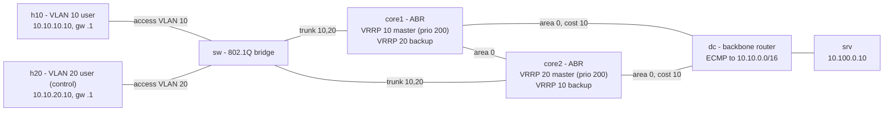

# Net Lab 07 — OSPF campus with a VRRP gateway pair: pull the plug on the active core and measure it

> **Status: runs in CI; results table is filled by the first CI run.** Everything below describes what the
> lab does and how each claim is checked. No number appears in the Results table until a GitHub Actions run
> has produced it.

**What it proves.** A two-core campus runs **OSPF with two areas** (area 0 backbone, area 1 = the user
VLANs, **summarised** to one /16 at the ABRs), reaches the data centre over **equal-cost paths (ECMP)**,
gives its users **802.1Q access VLANs** through a VLAN-aware Linux bridge, and protects their default
gateway with a **VRRPv3 pair** — each core is master for one VLAN, so both cores carry traffic. The lab
then **kills the active gateway router outright** (`docker kill`: processes and every cable gone, like a
power cut) while users send a UDP probe every 10 ms in both directions, and measures in milliseconds the
gap a user on the affected VLAN saw, the VRRP takeover, the OSPF reconvergence at the data-centre router,
the ECMP collapse and return, and the path change seen by `traceroute`. It then powers the core back on,
re-cables it, and proves **preemption is safe**: the returning router may not take the gateway back until
OSPF has given it a route to the servers — checked sample by sample. Users on the other VLAN are the
control group.

It runs on a GitHub-hosted runner with **containerlab**, **FRRouting** (OSPF) and **keepalived** (VRRP):
$0, no cloud account, no secrets, torn down at the end of every run.

## Topology



| Piece | Design |
|---|---|
| OSPF | area 0: core1, core2, dc (point-to-point links, hello 1 s / dead 4 s, explicit cost 10). Area 1: the user VLAN interfaces on both cores, **passive** (no hellos towards users), summarised with `area 1 range 10.10.0.0/16` |
| ECMP | dc receives the summary from both ABRs at equal cost and installs two next hops; `fib_multipath_hash_policy=1` hashes per flow on L4 ports |
| Access | `sw` is a Linux bridge with `vlan_filtering`: untagged access ports for h10 (VLAN 10) / h20 (VLAN 20), 802.1Q trunks to both cores; the cores use `eth1.10` / `eth1.20` sub-interfaces |
| Gateway | keepalived VRRPv3, advert 0.2 s (master declared dead after 3 × 0.2 s + skew ≈ 0.72 s), virtual IP `.1` on each VLAN, preemption on |
| Safe preemption | a keepalived **track script** (`configs/keepalived/chk_uplink.sh`) passes only when OSPF has installed the route to the server LAN; while it fails the priority drops by 150 (`init_fail`: it starts failed), so a booting core cannot claim the gateway and black-hole its users. This is the job `preempt delay` / object tracking does on Cisco or Arista |

### Why keepalived and not FRR's vrrpd

FRR's `vrrpd` implements VRRP with a macvlan carrying the virtual MAC and puts that macvlan into
`protodown` in the Backup state. In a software data plane the backup's macvlan still accepts frames sent
to the virtual MAC, and the kernel will route them — so when the master dies and the bridge floods the
virtual MAC, the "backup" quietly forwards before it has become master, and the measured gap would be a
Linux artifact rather than VRRP (on hardware the ASIC would not program the MAC). keepalived moves the
gateway **address** and announces it with gratuitous ARP: until it takes over, the backup genuinely
cannot forward for the gateway, so the gap measured here is the real VRRP gap. It is also the most widely
deployed VRRP implementation on Linux and runs unchanged in a container. Cost: keepalived is added to the
pinned FRR image in `Dockerfile` (built in CI, Alpine 3.22 package; the run records its version).

## How it is measured

* **Data plane** — `tools/probe.py`: a sequence-numbered UDP packet every 10 ms, h10 ↔ srv and h20 ↔ srv,
  both directions. Containers share the runner's kernel clock, so send/receive times compare directly.
  **Gap** = send time of the first packet delivered after the last lost one, minus send time of the first
  lost packet (it starts when packets start dying, which is a little after `docker kill` is issued).
* **Control plane** — `tools/poll.py` (~20–50 ms per sample, timestamped): on dc the route to
  10.10.0.0/16 and the OSPF neighbours; on core2 whether it holds the VLAN 10 gateway address; after
  power-on, on core1 the gateway address **and** its OSPF route to the servers. Times are measured from
  the moment `run.sh` issued the kill / power-on and quoted as the upper bound of the poll bracket.

## The scenario: `master_kill`

1. Baseline assertions: every OSPF adjacency Full; dc sees only the summary (no /24 leaks); dc's FIB has
   **both** cores as next hops for 10.10.0.0/16 **and** the kernel actually spreads 16 test flows over both;
   VRRP roles are exactly core1 = VLAN 10, core2 = VLAN 20 (no split brain); each host's ARP entry for its
   gateway is its master's MAC; `traceroute` first hop is the master's address.
2. `docker kill` core1 under traffic. Asserted: core1 stayed dead (containerlab's default restart policy
   for Linux nodes is *always* — the topology sets `"no"` and the run verifies it), VRRP takeover by core2,
   dc dropped the core1 adjacency and collapsed ECMP onto core2, traffic resumed **while core1 was still
   dead**, h10's ARP now points at core2's MAC (gratuitous ARP), `traceroute` first hop is now core2,
   and the control VLAN stayed within its limit.
3. `docker start` core1, re-create its cables (`containerlab tools veth create` — a container's veths die
   with it) and VLAN interfaces, **start keepalived while the backbone links are still dark**, wait
   4 s, then re-cable the backbone. Asserted: during those 4 s core1 never held the gateway (and had no
   route — the gate was really exercised), it never held the gateway without a route afterwards either,
   it then **preempted**, core2 released the address, dc's ECMP came back, failback loss under 1 s, and
   `traceroute` first hop is core1 again.

Limits: user gap ≤ 2 s on VLAN 10, ≤ 1 s on the control VLAN, VRRP takeover ≤ 2 s, OSPF reconvergence ≤ 2 s,
failback loss ≤ 1 s.

## Results

Filled by the first CI run (report in the job summary and `evidence/run-*/report.md`).

| Measurement | Value |
|---|---|
| User gap, VLAN 10 h10 → srv (gateway moved) | _filled by first CI run_ |
| User gap, VLAN 10 srv → h10 (return path) | _filled by first CI run_ |
| Control VLAN 20, both directions | _filled by first CI run_ |
| VRRP takeover (core2 holds 10.10.10.1) | _filled by first CI run_ |
| OSPF: dc reroutes 10.10.0.0/16 onto core2 only | _filled by first CI run_ |
| ECMP restored after core1 power-on | _filled by first CI run_ |
| Preemption after core1's backbone returns | _filled by first CI run_ |
| Loss during failback | _filled by first CI run_ |

## How to run

**In CI (the evidence of record):** push a change under this directory, or *Actions → net07-ospf-campus-vrrp →
Run workflow*. Job `test` runs pytest + linters; job `lab` installs containerlab 0.79.0, builds the core image,
runs `run.sh`, writes the report to the job summary, uploads `evidence/` and always destroys the lab.

**On your own Linux box** (Docker + containerlab, ~1 GB RAM, ~3 minutes):

```bash
cd networking/net-07-ospf-campus-vrrp
./run.sh                 # builds net07-core:local, deploys, baseline, kill + measure + failback, report, destroy
KEEP=1 ./run.sh          # leave it up: docker exec -it clab-net07-dc vtysh -c 'show ip ospf neighbor'
python3 -m pytest        # offline: measure.py against real-run fixtures, incl. ones that must fail
```

## Layout

```
topology.clab.yml            containerlab topology (images pinned; core image built from ./Dockerfile)
Dockerfile                   quay.io/frrouting/frr:10.6.2 + keepalived 2.3 (same Alpine release)
configs/{core1,core2,dc}/frr.conf    OSPF; configs/{core1,core2}/keepalived.conf    VRRPv3 + track script
configs/keepalived/chk_uplink.sh     the "do I have a route to the servers?" gate
run.sh                       build -> deploy -> baseline -> kill -> measure -> power on / re-cable -> report -> destroy
measure.py                   probe logs + vtysh/iproute2 JSON -> PASS/FAIL checks, ms values, report.md (stdlib only)
tools/probe.py, tools/poll.py   10 ms one-way UDP probe; timestamped state sampler
tests/                       pytest: the real-run fixture must PASS; mutated copies (no failover, gap over the limit,
                             no VRRP takeover, no preemption, preempting before routing is up, an untested gate,
                             core1 resurrected by Docker, host ARP still on the dead master, ECMP never restored,
                             missing scenario, sabotaged result file) must FAIL
```

The fixture in `tests/fixtures/` is a real run captured during development by running these exact configs
on plain Docker, where links are Docker bridges and **killing core1 does not drop carrier on dc's side** —
so there dc had to wait for the 4 s OSPF dead interval and the return path lost traffic for about that long.
Its `meta.json` relaxes exactly those two limits (and says so), and a test proves that with the CI limits
that same run FAILS exactly those two checks. On containerlab the killed container's veths are deleted with
it, so dc sees the link vanish; whether that holds on the runner is what the first CI run shows.

## Be ready to explain

- **VRRP mechanics**: master advertisement interval, Master_Down_Interval = 3 × interval + skew, skew =
  ((256 − priority) / 256) × interval, preemption, what happens to hosts (they never change gateway IP;
  gratuitous ARP moves their ARP entry — or, with a virtual MAC, the switch's MAC table moves instead).
- **VRRP vs HSRP vs GLBP**, and why one master per VLAN on different cores is the usual way to use both boxes.
- **Safe preemption**: why a router that wins the election before its routing has converged black-holes users,
  and the three fixes (preempt delay, tracking, `init_fail`-style start-up state).
- **OSPF areas**: ABR, LSA types 1/2/3, what `area range` does to the backbone's table and to failure
  propagation, why user-facing interfaces are passive.
- **ECMP**: a route with two next hops in the FIB vs. per-flow hashing in the kernel (L3 vs L4 hash policy),
  why one flow never splits across paths, and asymmetric routing (outbound via the VRRP master, return via
  ECMP) — what that means for stateful firewalls.
- **Failure detection**: carrier loss (instant) vs. hello/dead timers (seconds) vs. BFD (sub-second, would be
  the next step for OSPF here), and which one decided each number in the report.
- **Why keepalived over FRR vrrpd** for this lab (above) — the general lesson: know whether your control-plane
  state actually gates the data plane.

## Honest limits

- One kernel, a few vCPUs, keepalived and FRR in software: numbers carry runner jitter and come from one run.
- "Power loss" is `docker kill`. A real core failing behind a switch would not drop carrier at dc; then the OSPF
  dead interval (or BFD) decides the return-path gap, as the development fixture shows.
- No STP, LACP or first-hop security; the access switch is a single Linux bridge.
