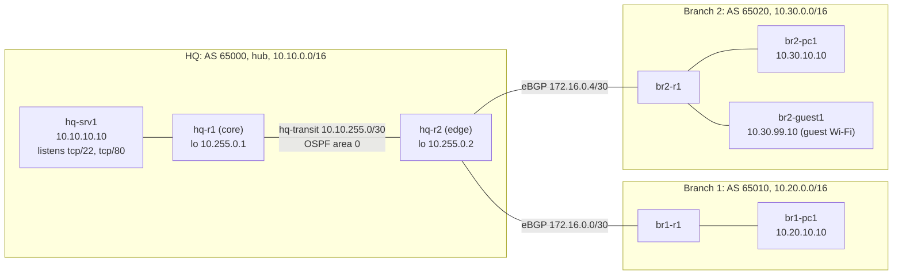

# Lab N8: Network as code ("GitOps for the network")

**What this proves, in one paragraph.** The whole network is described in one YAML file
([`intent/network.yaml`](intent/network.yaml)): sites, routers, interfaces, the IP plan, the
OSPF and BGP design, and the ACL policy. Nobody configures a router by hand. A Python
generator renders FRRouting configs, firewall rules and a containerlab topology from that
file. The generator refuses to run until a validator passes: a schema check, then
overlapping-subnet, duplicate-IP and "every interface in exactly one subnet" checks, then
checks on the routing and ACL intent. CI then builds the network for real on the GitHub
runner (4 FRR routers, 4 Linux hosts, 3 sites, eBGP + OSPF) and tests the live network
against the same intent:
- every BGP session, OSPF adjacency and expected route is present;
- every host pair can reach each other where policy allows;
- traffic is blocked where policy says deny, and the right ACL rule is what blocked it.

Then it makes three out-of-band changes on the routers. The drift check has to report each
one, re-applying intent has to heal them, and the tests run again. A simulated pull request
that introduces an overlapping subnet has to be **rejected before anything is rendered**.
The same change made correctly has to be accepted. That second case is the control: it
shows the gate is not just rejecting everything.

> **Status: code complete, first CI run pending.** Every number under
> [Results](#results-filled-by-the-first-ci-run) is filled in from a real run's evidence. None are
> estimates. The offline layer (116 unit tests) has been run; the containerlab layer only runs on
> a machine with Docker (the GitHub runner).

## The pipeline

```mermaid
flowchart LR
  pr[PR changes<br/>intent/network.yaml] --> schema[schema check<br/>typos, types, pinned images]
  schema --> plan[address plan<br/>overlaps, duplicate IPs,<br/>1 subnet per interface]
  plan --> intent[intent sanity<br/>BGP/OSPF shape, route to every LAN,<br/>ACL shadowing, probes agree with ACLs]
  intent -->|any error| reject([REJECTED<br/>nothing rendered])
  intent -->|clean| gen[generate<br/>Jinja2 -> FRR configs,<br/>iptables rules, topology]
  gen --> snap{rendered/ snapshot<br/>matches?}
  snap --> deploy[containerlab deploy<br/>FRR 10.4.5 + netshoot]
  deploy --> conv[wait for convergence<br/>measured]
  conv --> tests[post-deploy tests<br/>BGP, OSPF, RIB, ACLs,<br/>16-probe reachability matrix]
  tests --> drift[drift demo<br/>baseline clean -> inject 3 changes<br/>-> each detected -> re-apply -> clean]
  drift --> again[tests again]
  again --> ev[(evidence JSON + SUMMARY.md<br/>artifact + job summary)]
  ev --> destroy[destroy, always<br/>+ survivor check]
```



## The network it builds



**Routing design (all of it derived from intent, none of it hand-typed):**
- **eBGP between sites**, one private ASN per site. Hub and spoke: the branches peer only with
  hq-r2, and branch-to-branch traffic goes through HQ.
- **Every eBGP session has an inbound and an outbound policy** (prefix-list + route-map). Each
  list is computed from intent:
  - a spoke exports only its own LANs, so it can never become a transit path;
  - the hub accepts from each spoke only that spoke's LANs, so a branch cannot hijack HQ's
    prefixes.
- **OSPF inside HQ.** Point-to-point network type on the transit link; the loopbacks and the
  server LAN are passive.
- **hq-r2 redistributes BGP into OSPF** through a route-map that lets only the branch LANs
  through, so hq-r1 learns the branches as OSPF externals.
- **The ACL policy** is in the source of truth:
  - guest Wi-Fi reaches nothing internal;
  - branch 1 may not SSH to the servers, but may use the web service.

  Each rule is enforced on the gateway of its source LAN (filter close to the source), as a
  stateful iptables chain in that router's network namespace. Return traffic of allowed flows
  passes. First match wins. The default is permit.

## Layout
```
networking/net-08-network-as-code/
├── intent/network.yaml        THE source of truth (the only file a change should touch)
├── intent/schema.json         JSON Schema: structure, types, no unknown keys, no :latest images
├── changes/                   simulated PRs: pr-041 (correct, must be ACCEPTED), pr-042 (overlap, must be REJECTED)
├── templates/                 Jinja2: frr.conf, daemons, vtysh.conf, acl.rules (iptables-restore), topology.clab.yml
├── rendered/                  committed generator output, so a reviewer sees the config diff in the PR
├── netaac/                    the toolkit (python -m netaac <command>)
│   ├── intent.py              strict YAML loader (duplicate keys are an error) + apply a change to a copy
│   ├── validate.py            4-layer validator, stable finding codes
│   ├── model.py               derived network: links, BGP policy, expected routes/peers/adjacencies, probes
│   ├── generate.py            render (refuses invalid intent) + plan.json
│   ├── checks.py              pure PASS/FAIL evaluators for vtysh JSON, iptables counters, probes
│   ├── drift.py               running-config vs intent diff + remediation commands
│   ├── live.py                post-deploy, convergence, tests, drift demo (driven through a lab interface)
│   ├── lab.py                 the only module that touches Docker (docker exec / nsenter)
│   └── report.py              evidence JSON per phase + SUMMARY.md
├── scripts/                   deploy.sh, destroy.sh (+ survivor check), run-lab.sh (full local run), collect-diag.sh
└── tests/                     116 pytest tests incl. tests/fakenet.py, a simulated lab with fault injection
.github/workflows/net08.yml    offline gate on every push/PR; deploy + tests + drift on main / manual run
```

## What is checked

**1. Pre-deploy validation** (`python -m netaac validate`). It runs in four layers and stops at
the first layer that has errors. Every finding has a code, so a test can assert *why* a change
was rejected, not just *that* it was.

| Layer | Examples of what it rejects (code) |
|---|---|
| Schema | unknown or misspelt key (`SCHEMA`), wrong type, an image without a pinned tag, a repeated YAML key that PyYAML would silently merge (`DUPLICATE_KEY`) |
| Addressing | a prefix with host bits set (`PREFIX_NOT_NETWORK`), a reference to a site, subnet, router or host that does not exist (`REF_UNKNOWN`) |
| Plan | overlapping subnets (`SUBNET_OVERLAP`), overlap with the containerlab management network (`MGMT_OVERLAP`), the same IP assigned twice (`DUPLICATE_IP`), an interface outside its subnet (`IFACE_NOT_IN_SUBNET`) or inside two subnets (`IFACE_MULTI_SUBNET`), a network or broadcast address (`RESERVED_ADDRESS`), a subnet outside its site's block (`OUTSIDE_BLOCK`) |
| Intent | a p2p link without exactly 2 routers, a LAN without exactly 1 gateway, a duplicate ASN, iBGP or spoke-to-spoke sessions, OSPF on one side of a link only (`OSPF_ONE_SIDED`), **any router left without a route to a host LAN** (`ROUTE_GAP`); ACL rules that can never match: shadowed by an earlier rule (`ACL_SHADOWED`) or source and destination in the same LAN (`ACL_SAME_SUBNET`); **a declared probe that contradicts the ACL rules** (`PROBE_CONTRADICTS_ACL`), a TCP probe to a port nothing listens on |

**2. The bad-change demo** (`python -m netaac change-demo`). Each file in `changes/` is
applied to a copy of the source of truth, the way a PR would change it. The merged copy is
saved as evidence and then validated.
- **pr-041** adds branch 3 correctly and must be ACCEPTED.
- **pr-042** adds the same branch, but its user LAN is typed as `10.20.10.0/25`, which overlaps
  branch 1. It must be REJECTED, the reasons must include `SUBNET_OVERLAP`, and the generator
  must refuse to render it.

**3. Post-deploy tests** (`python -m netaac test`), 46 checks against the live lab:
- **ACLs installed:** on each enforcing router, the iptables chain has every rule in intent
  order and the jump from FORWARD.
- **BGP:** every intended session is Established with the right remote AS. The received and
  sent prefix counts equal what the per-neighbor policy should allow. That second check tests
  the policy, not just the session.
- **OSPF:** every intended adjacency is Full.
- **Routing table:** every expected prefix on every router is selected, installed in the FIB
  and learned by the expected protocol (connected / ospf / bgp). 18 route checks.
- **Reachability matrix:** an ICMP probe for every ordered host pair (12), plus 4 declared TCP
  probes. 5 of the 16 must be denied.
  - **A deny passes only if the probe failed AND the counter on the ACL rule that intent says
    should block it went up.** A probe that fails because routing is broken is scored FAIL
    ("blocked, but not by the ACL"), never as the policy working.

**4. Drift demo** (`python -m netaac drift-demo`):
1. **Baseline:** every router's running config equals the rendered config. If this were already
   red, the detection step below would prove nothing.
2. **Inject three out-of-band changes**, chosen from intent rather than hard-coded:
   - an undocumented static route on a branch router;
   - an OSPF cost changed on an HQ interface;
   - a configured BGP line deleted on the box.
3. **Detect:** each change must appear in the drift report as the exact line, in its
   context, of the right kind (extra or missing). No other differences may be reported
   (precision).
4. **Heal:** FRR's own `frr-reload.py` re-applies the intended config, removals included. If
   drift remains, vtysh commands computed from the diff are the fallback. Every router must
   end clean, and the full test suite runs again.

The diff compares sets of context-qualified lines (for example
`router bgp 65010 > address-family ipv4 unicast > network 10.20.10.0/24`). The order FRR prints
blocks in does not matter, but a line that moved to a different block is still drift. A short,
explicit list of lines FRR adds by itself is ignored (`frr version`, `end`, `exit`, forwarding
state).

**How the tests themselves are tested.** The checks can fail, and that has been shown, not
assumed.
- **Pure functions, recorded inputs.** Every checker is a pure function tested against recorded,
  FRR-shaped output. Each has inputs that must produce FAIL: a session in Active, the wrong
  remote AS, a prefix count off by one, a 2-Way OSPF neighbor, a static route where BGP was
  expected, an uninstalled route, rules in the wrong order, a missing FORWARD jump.
- **A simulated lab with fault injection** (`tests/fakenet.py`) drives the live code end to end.
  A healthy fake must give an all-PASS run. Each fault must turn its own check red:
  - ACL not installed (reachable but should be denied);
  - an ACL rule leaking;
  - a broken path (unreachable but should reach, or denied for the wrong reason);
  - a missing listener;
  - a BGP session down;
  - the wrong route protocol;
  - a `show running-config` that never changes (a blind drift detector);
  - a failed heal.
- **Sabotaged reporters.** The tests also break the *reporters*, not just the data: a diff
  function that always says "clean", a prober that always fails, a generator gate that would
  render a rejected change. Each must turn the run red.
- **Mutation check**, run by hand while building this lab. 20 deliberate bugs were introduced
  one at a time, and each one made the suite fail (20/20 killed):
  - the overlap check removed, the duplicate-IP threshold loosened;
  - a deny accepted without a counter;
  - the route protocol ignored, BGP Active accepted as up;
  - static routes ignored by the drift check, the block context dropped from the diff;
  - default-deny semantics, a spoke exporting everything;
  - the outbound route-map removed, the ACL's ingress interface removed;
  - detection always true, the heal check skipped;
  - an empty phase counted as passing, a missing phase ignored, the generator refusal not
    required;
  - and others.

## How to run

**Offline (any machine with Python 3.11+, no Docker). This is what runs on every PR:**
```bash
cd networking/net-08-network-as-code
python3 -m venv .venv && . .venv/bin/activate && pip install -r requirements-dev.txt
ruff check . && python -m pytest                      # 116 tests
python -m netaac validate                             # the source of truth
python -m netaac change-demo                          # pr-041 ACCEPTED, pr-042 REJECTED (SUBNET_OVERLAP)
python -m netaac generate --out build                 # render; refuses invalid intent (exit 2)
python -m netaac check-rendered                       # committed rendered/ == generator output
```
After you edit `intent/network.yaml`, re-render the reviewed snapshot with
`python -m netaac generate --out rendered` and commit it with the change.

**The full lab (Linux with Docker, [containerlab](https://containerlab.dev) and passwordless sudo):**
```bash
scripts/run-lab.sh              # validate -> deploy -> converge -> tests -> drift demo -> tests -> report -> destroy
KEEP=1 scripts/run-lab.sh       # leave it running, then e.g.:
docker exec -it clab-net08-br1-r1 vtysh -c 'show bgp summary'
docker exec -it clab-net08-br2-guest1 ping -c2 10.10.10.10     # denied by guest-no-hq-servers
scripts/destroy.sh
```

**In CI:** push to `main` touching this directory, or use *Actions → net08-network-as-code →
Run workflow*. Every run uploads its evidence as the `net08-evidence-<run id>` artifact:
- one JSON file per phase;
- `SUMMARY.md`, which also appears as the job summary;
- the rendered configs that were deployed;
- the image digests that were pulled;
- raw router state on failure.

The runner needs nothing paid and no secrets. The pins:
- containerlab **0.79.0** (`.deb` verified by sha256 in the workflow)
- FRR image **quay.io/frrouting/frr:10.4.5**
- host image **nicolaka/netshoot:v0.16**

## Results: first CI run, [GitHub Actions 38951045761](https://github.com/ravikus1457/aws-labs/actions/runs/38951045761), 2026-10-16 (202 checks passed, 0 failed)
| Measure | Value | Source |
|---|---|---|
| Unit tests (offline) | 116 passed locally; CI: 116 passed | pytest |
| Mutation check (offline) | 20/20 deliberate bugs caught | done by hand while building, see above |
| Validation of the real intent | ACCEPT, 0 errors, 0 warnings (local) | `validate.json` |
| Bad change pr-042 | REJECTED (`SUBNET_OVERLAP`, plus `OUTSIDE_BLOCK` and 4 × `IFACE_MULTI_SUBNET`), generator refused (local) | `change-demo.json` |
| `containerlab deploy` time | 1 s | deploy step log |
| Control-plane convergence after config applied | 14.6 s | `converge.json` (polled every 2 s) |
| Post-deploy checks passed | 46 of 46 | `test-initial.json` |
| Reachability probes passed / must-deny probes proven by ACL counters | 16 of 16 / 5 of 5 | `test-initial.json` |
| Out-of-band changes detected | 3 of 3 | `drift-demo.json` |
| Heal time and method | 0.9 s, `frr-reload.py` on all 3 drifted routers | `drift-demo.json` |
| Checks passed after heal | 46 of 46 (and 29 of 29 re-convergence checks) | `test-post-heal.json` |
| Containers left after destroy | 0 | destroy step log |

## Decisions and trade-offs
| Decision | Chosen | Why / alternatives |
|---|---|---|
| Network OS | **FRRouting in containers** | Real routing daemons (the same bgpd/ospfd used in production on Linux and SONiC). It runs free on a GitHub runner, where vendor images (cEOS, SR Linux, vMX) need licences, registration or more RAM. The config concepts carry over: prefix-lists, route-maps, eBGP policy, OSPF passive and network types. |
| Orchestrator | **containerlab** | Topology as a file, wires veth pairs between containers, the de-facto standard for container network labs. Pinned and checksum-verified in CI. |
| Source of truth | **one YAML file + JSON Schema** | In production this is usually NetBox or Nautobot behind an API. A file in git gives the same review flow (PR, diff, approval) with no server. The schema rejects unknown keys so a typo cannot silently mean "not set". |
| Rendered configs | **committed in `rendered/`, checked in CI** | The PR shows the *config* diff a change causes, not just the YAML diff. That is what a network reviewer needs to see. CI fails if anyone edits rendered output by hand or forgets to re-render. |
| eBGP policy | **explicit in/out policy on every session** | FRR enforces RFC 8212 (no policy, no routes) by default. Per-neighbor lists computed from intent mean a branch cannot leak or hijack prefixes. The BGP prefix-count check proves the policy on the live sessions. |
| ACL enforcement | **stateful iptables, on the source LAN's gateway** | FRR's `access-list` filters routes, not packets, so the data-plane filter is netfilter in each router's namespace. Rules are applied from the runner with `nsenter`, because the FRR image ships no iptables. Filtering at the source drops unwanted traffic before it crosses the WAN. |
| ACL default | **permit, with deny rules** | Default-deny is the production choice for a perimeter. It needs an explicit permit for every flow, including the routing protocols themselves where they cross a filter, so it was left as an extension. The schema makes the default explicit (`default_action: permit`) instead of implied. |
| Deny verification | **counter attribution** | "The ping failed" is not proof of policy. A dead link fails a ping too. A deny passes only when the intended rule's packet counter went up during the probe. |
| Drift heal | **`frr-reload.py`, fallback to computed vtysh commands** | frr-reload is FRR's own diff-and-apply tool and handles removals. The fallback is recorded in the evidence when it is used, so the heal method is never hidden. |
| Hosts per LAN | **one** (validator enforces `LAN_HOSTS`) | Each LAN is a veth pair. More hosts would need a Linux bridge node; the validator says so instead of failing at deploy time. |

## Known limitations (said plainly)
- **Not yet run end to end.** The FRR output formats the checks parse were written from FRR's
  documented JSON and running-config style and recorded as test fixtures. The first CI run is
  where they meet the real thing. The two likeliest first-run surprises:
  - a line FRR prints that is not in the ignore list, which would show as baseline drift with
    the exact line in the evidence;
  - a JSON field renamed between FRR versions. The parsers already accept both known OSPF
    state keys, and missing BGP prefix counts are reported as SKIP, not PASS.
- The drift check covers FRR config. The ACL is verified behaviourally (rules present in
  order, counters move, probes) but iptables state is not diffed line by line.
- Convergence time is measured by polling every 2 s, so it has ±2 s resolution and includes
  container start-up. It is not a protocol-timer benchmark.
- IPv4 only. One area, one hub, one host per LAN: the validator refuses designs outside that
  envelope instead of half-supporting them.

## Résumé bullet (only after you have run it and can explain every word)
> Built a network-as-code pipeline: a YAML source of truth is validated (schema, overlapping
> subnets, duplicate IPs, routing and ACL intent), rendered with Python/Jinja2 into FRRouting
> configs and stateful ACLs, and deployed with containerlab in GitHub Actions (3 sites, eBGP
> with per-neighbor prefix policy, OSPF, BGP→OSPF redistribution). Automated post-deploy tests
> check BGP/OSPF state and every expected route via vtysh JSON. A reachability matrix proves
> allowed flows pass and denied flows are dropped by the intended ACL rule (counter-attributed).
> A drift check catches out-of-band router changes and re-applying intent heals them. An
> overlapping-subnet pull request is rejected before deploy. *(Add the measured numbers from
> the first green run, and only those.)*

## Be ready to explain
- **Why a source of truth plus generated config** beats editing routers: review, history,
  rollback, and drift as a measurable thing. Where NetBox or Nautobot fit, and what "intent"
  means compared with "config".
- **Validation layers:** why schema runs first, why overlaps are checked pairwise (and the
  O(n²) cost at scale: a sorted sweep or a radix tree is the fix), and why "every interface in
  exactly one subnet" catches overlaps that two separate checks would not.
- **eBGP basics:** ASN per site, why RFC 8212 makes FRR drop routes with no policy, prefix-list
  vs route-map, why a spoke must not export transit routes, what `pfxRcd`/`pfxSnt` count.
- **OSPF:** area 0, passive interfaces, point-to-point vs broadcast network type (no DR/BDR),
  router-id from the loopback, external type-2 routes from redistribution.
- **Redistribution:** why it is filtered, and what goes wrong with mutual redistribution
  (loops, which is why this design only redistributes one way).
- **Stateful vs stateless ACLs:** what conntrack ESTABLISHED/RELATED does to return traffic,
  where to place an extended ACL (near the source) and why, first-match semantics and
  shadowed rules.
- **Why a failed ping is not proof of a deny,** and how counter attribution fixes that.
- **Drift:** why the diff is set-based with context, what the ignore list is and why it must
  stay short, what frr-reload does, and why the baseline must be clean before the test means
  anything.
- **containerlab:** veth links, the management network, why the lab's IP plan must not
  overlap it, why `nsenter` is needed to run iptables in a router's namespace.
- **Testing the tests:** fault injection, sabotaging the reporter, and mutation testing. Have a
  concrete example ready (a deny counted as PASS without a counter would have hidden a broken
  path).
